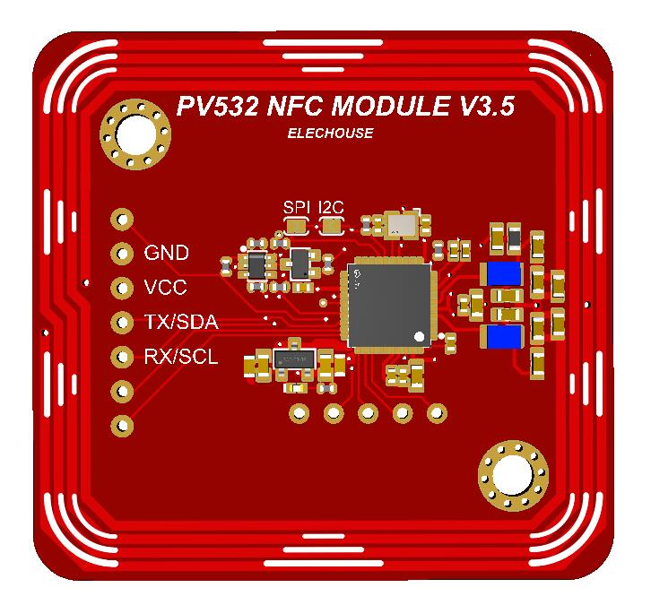
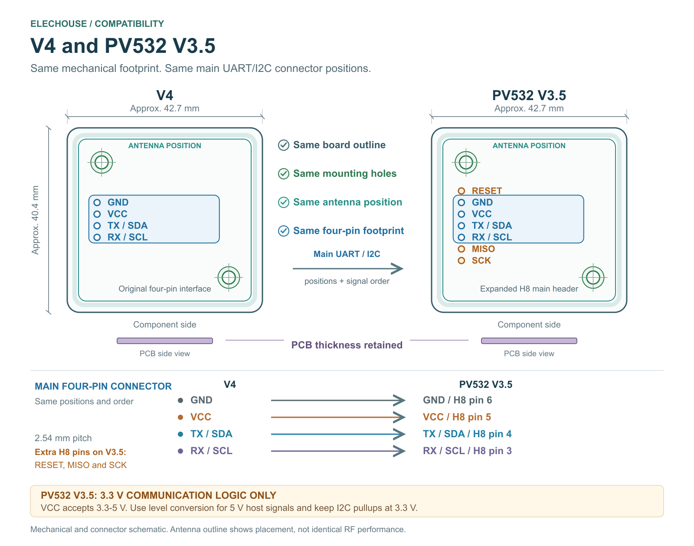

# ELECHOUSE PN5321 Arduino Library

Arduino library and ESP32-C3 UART test software for the
[ELECHOUSE PV532 NFC RFID Module V3.5](https://www.elechouse.com/product/pv532-nfc-rfid-module-v3-5/).
The module uses **FSVP532, compatible with PN5321**, with firmware **1.6**.

[](https://www.elechouse.com/product/pv532-nfc-rfid-module-v3-5/)

This repository is an ELECHOUSE-maintained fork of the PN532 Arduino library.
The `PN532-Arduino` package identifier, `PN532` class and transport header names
are retained for software compatibility. They do not identify the chip fitted
to the PV532 module. Original contributors and license notices are retained.

## Product and documentation

| Item | PV532 V3.5 |
| --- | --- |
| NFC controller | FSVP532, compatible with PN5321 |
| Module firmware | 1.6 |
| Operating frequency | 13.56 MHz |
| Supply at VCC | 3.3-5 V DC |
| Communication signals | **3.3 V logic only** on I2C, SPI and UART |
| Host interfaces | I2C, SPI and HSU UART; select one at a time |
| Antenna | Integrated PCB antenna |
| Nominal PCB outline | Approximately 42.7 x 40.4 mm |

- [ELECHOUSE product page](https://www.elechouse.com/product/pv532-nfc-rfid-module-v3-5/)
- [User manual, revision 1.4 (PDF)](https://www.elechouse.com/wp-content/uploads/2026/11/PV532_V3_5_User_Manual_v1_4.pdf)
- [3D model (STEP)](https://www.elechouse.com/wp-content/uploads/2026/11/PV532_V3_5_3D.step)
- [Technical support](https://www.elechouse.com/contact/)

## Compatibility with ELECHOUSE V4

PV532 V3.5 retains the V4 board size, PCB thickness, mounting-hole positions,
antenna position and main four-pin UART/I2C connector footprint and signal order.

Compared with V4, PV532 V3.5 provides more convenient SPI wiring on the expanded
2.54 mm main header, supports a 3.3 V supply, and brings RESET to the main header.
The electrical tradeoff is **3.3 V communication logic only**. A 5 V supply at
VCC does not make the signal pins 5 V tolerant. Use suitable level conversion
for 5 V host outputs and keep I2C pullups at 3.3 V. SPI and auxiliary connections
must follow the PV532 pin definitions.



## Main header and interface selection

Pin numbers refer to the component-side view in the user manual. RX and TX
are named from the module's perspective.

| H8 pin | Signal | Function |
| --- | --- | --- |
| 1 | SCK | SPI clock |
| 2 | MISO | SPI data to the host |
| 3 | SS / SCL / RX | SPI select / I2C clock / UART receive |
| 4 | MOSI / SDA / TX | SPI data from the host / I2C data / UART transmit |
| 5 | VCC | 3.3-5 V supply |
| 6 | GND | Common ground |
| 7 | RESET | Active-low RSTPD_N; may be left unconnected for basic operation |

| Mode | I2C solder jumper | SPI solder jumper |
| --- | --- | --- |
| HSU UART | Open | Open |
| I2C | Bridged | Open |
| SPI | Open | Bridged |

Disconnect power before changing jumpers and power cycle afterward. Do not
bridge both jumpers. HSU uses 115200 baud, 8N1; the I2C 7-bit address is `0x24`.

## Standalone ESP32-C3 card range test

For card identification and manual reading-distance checks, start with the
[ESP32-C3 UART range-test guide](extras/esp32c3-range-test/README.md) and
[standalone sketch](extras/esp32c3-range-test/PN532_All_Cards_UART_Range_Test).
This program includes its own HSU driver and needs **no external NFC or NDEF library**.

It provides AUTO or fixed-protocol scanning, manual sample names and distances,
20-attempt statistics and CSV result lines. Type A, Type B, FeliCa 212/424,
Jewel/Topaz and a dedicated ST SR-family entry are available. Identification,
Classic authentication/reads and Type 2 reads/version queries use separate
criteria. The program does not write card data or measure physical distance.
See the guide for the current hardware-validation scope.

Reference host wiring is for the **LuatOS CORE-ESP32-C3**:

| PV532 V3.5 | ESP32-C3 |
| --- | --- |
| H8 pin 4 TX / SDA | GPIO4, UART1 RX |
| H8 pin 3 RX / SCL | GPIO5, UART1 TX |
| H8 pin 5 VCC | 3.3 V |
| H8 pin 6 GND | GND |

Leave both mode jumpers open. The reference board uses GPIO12 for its D4 LED
and GPIO13 for D5; adapt the LED assignments for other boards.

## General Arduino library

The `src/` library supports I2C, SPI, hardware UART and software UART transports.
The [general examples](examples) cover UID reading and application operations.
Some examples require [Don's NDEF library](https://github.com/don/NDEF), which
is declared as a package dependency. These examples are separate from the
self-contained ESP32-C3 test above.

### Install this fork

Download [this repository's Arduino-branch ZIP](https://github.com/wilson-elechouse/PN5321/archive/refs/heads/arduino.zip)
and install it as an Arduino library, or clone it into your sketchbook's
`libraries/PN532-Arduino` folder:

```sh
git clone --branch arduino https://github.com/wilson-elechouse/PN5321.git PN532-Arduino
```

The installed library folder must contain `library.properties` and `src/`.
Install NDEF when required by the package manager or the selected example.

### Select a transport

| Interface | Build definition | Header |
| --- | --- | --- |
| I2C | `NFC_INTERFACE_I2C` | `PN532_I2C.h` |
| SPI | `NFC_INTERFACE_SPI` | `PN532_SPI.h` |
| Hardware UART | `NFC_INTERFACE_HSU` | `PN532_HSU.h` |
| Software UART | `NFC_INTERFACE_SWHSU` | `PN532_SWHSU.h` |

The definitions must reach the transport `.cpp` files. For a new Arduino CLI
sketch, pass the selected definition to the whole C++ build, for example:

```sh
arduino-cli compile --fqbn <your-board-fqbn> --build-property "compiler.cpp.extra_flags=-DNFC_INTERFACE_HSU" <your-sketch-folder>
```

Defining a macro only in a sketch does not enable a separately compiled
transport implementation. The existing repository examples explicitly include
their selected transport implementation; follow each example's selection block.

For ESP32 hardware UART, specify the host RX and TX pins in the constructor:

```cpp
#include <PN532_HSU.h>
#include <PN532.h>

HardwareSerial pnSerial(1);
PN532_HSU transport(pnSerial, 4, 5); // Host RX=GPIO4, TX=GPIO5
PN532 nfc(transport);
```

Cross UART signals: module TX to host RX and module RX to host TX.
Use a common ground and 3.3 V signal levels. Configure I2C/SPI host pins for
your board; the classic ESP32 examples in the product manual use different
host pins from the ESP32-C3 range test.

For PlatformIO users, point `lib_deps` to this fork and select the same transport:

```ini
lib_deps =
    https://github.com/wilson-elechouse/PN5321.git#arduino
build_flags = -DNFC_INTERFACE_HSU
```

## Protocol and example scope

The module and software provide PN5321-compatible NFC command workflows.
Tag identification, memory access, NDEF, authentication, peer-to-peer operation
and card emulation depend on the selected program and card. An available
software entry is not a claim that every card family has been tested.
The standalone range test does not implement ISO15693, 125 kHz LF or UHF RFID.

## Attribution and license

This fork retains the work of [Adafruit](https://github.com/adafruit/Adafruit_NFCShield_I2C),
[Seeed Studio](https://github.com/Seeed-Studio/PN532) and the original contributors,
including Baozhu Zuo, Yihui Xiong, awieser and Jiapeng Li. Don's NDEF library is
a separate dependency. ELECHOUSE maintains this fork's product documentation
and ESP32-C3 range-test additions.

See [LICENSE.md](LICENSE.md) for the BSD 3-Clause license and original copyright
notices. Individual source files may carry additional attribution.
